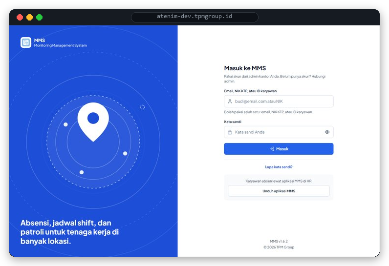
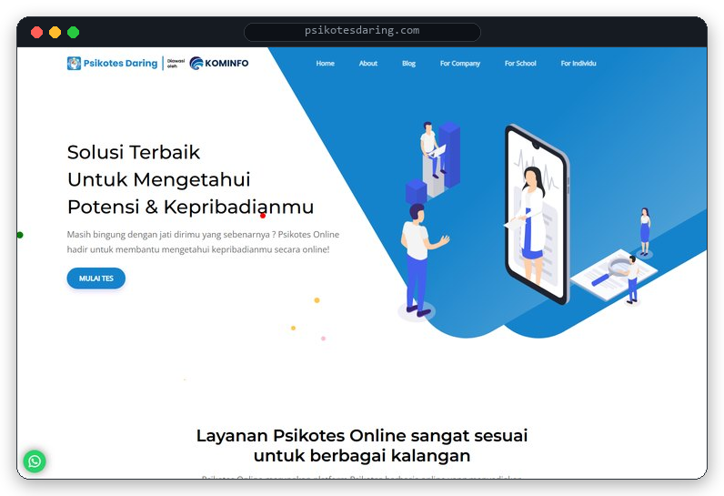
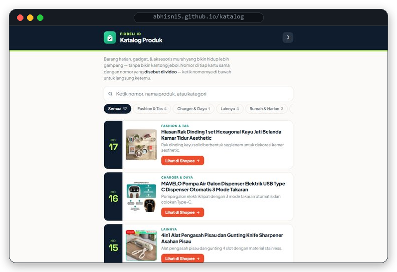
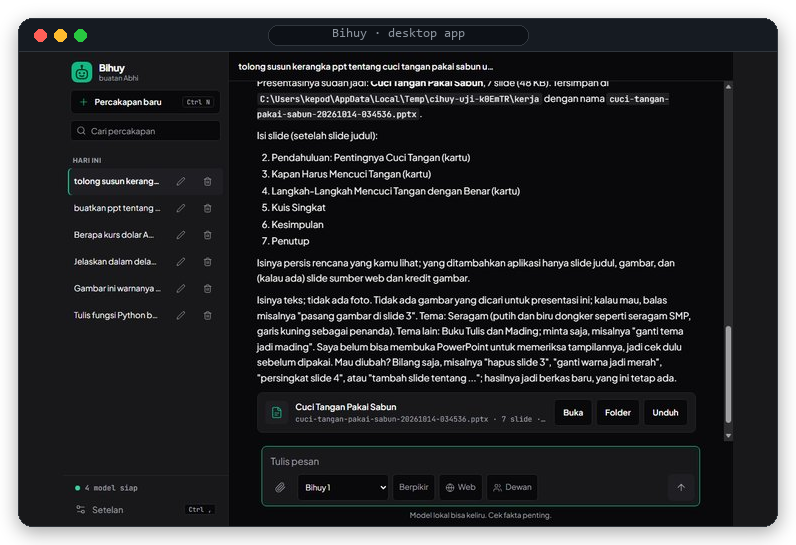

<a href="https://biporto.vercel.app">
  <picture>
    <source media="(prefers-color-scheme: dark)" srcset="assets/header-dark.svg">
    <source media="(prefers-color-scheme: light)" srcset="assets/header-light.svg">
    
  </picture>
</a>

  
  
  

Fullstack developer in Jakarta. Since September 2025 I've been at **TPM Group**, building and maintaining internal web and mobile tools alongside day-to-day IT support. Before that: a Production Engineering internship at **PT Denso Indonesia** and freelance work for a community organization.

- **Interfaces** · React, Next.js, React Native, Flutter
- **Behind them** · PHP + Laravel, Express.js, Python, with MySQL or SQL Server
- **Lately** · interactive 3D and page transitions with GSAP and Three.js

Have a project in mind? [Let's talk.](mailto:abhisuryanu9roho@gmail.com)

<picture>
  <source media="(prefers-color-scheme: dark)" srcset="assets/stack-dark.svg">
  <source media="(prefers-color-scheme: light)" srcset="assets/stack-light.svg">
  
</picture>

<picture>
  <source media="(prefers-color-scheme: dark)" srcset="assets/title-work-dark.svg">
  <source media="(prefers-color-scheme: light)" srcset="assets/title-work-light.svg">
  
</picture>

<table>
  <tr>
    <td width="50%" valign="top">
      
      <h4><a href="https://atenim-dev.tpmgroup.id/login">MMS · Monitoring Management System</a> · 2025–now</h4>
      The workforce platform I design and build at TPM Group, in daily production use: attendance gated by Face ID with a liveness check, plus GPS and a QR code that rotates every 30 seconds; shifts and schedules; leave and correction approvals; security patrols with QR checkpoints; real-time location monitoring; payroll slips; and company asset handover. A web dashboard for four roles and a Flutter app for employees.  
      <code>Next.js</code> <code>TypeScript</code> <code>Prisma</code> <code>MySQL</code> <code>Flutter</code>
    </td>
    <td width="50%" valign="top">
      
      <h4><a href="https://psikotesdaring.com">Psikotes Daring</a> · 2026</h4>
      Online psychological testing platform (PAPI, MBTI, DISC, RMIB, CFIT, IST, IQ) that reports 400,000+ users and 50+ client companies. I work on the backend that serves both the website and the Flutter app: scoring, PDF result certificates, Midtrans and Xendit payments, and anti-fraud filtering, and I'm building its version 2.  
      <code>PHP</code> <code>CodeIgniter</code> <code>MySQL</code> <code>Google Cloud Storage</code> <code>Flutter</code>
    </td>
  </tr>
  <tr>
    <td width="50%" valign="top">
      
      <h4><a href="https://abhisn15.github.io/katalog/">FixBeli ID</a> · 2026</h4>
      An automated pipeline that turns a product link into a finished vertical video on its own: AI writes the script through a five-provider fallback chain, a local LLM picks matching stock footage, FFmpeg renders it, and uploads are scheduled to YouTube and Facebook, all driven from a custom Android app.  
      <code>Python</code> <code>FFmpeg</code> <code>Ollama</code> <code>YouTube Data API</code> <code>Android</code>
    </td>
    <td width="50%" valign="top">
      
      <h4>Bihuy Chat · 2026</h4>
      A private AI assistant that runs entirely on one gaming PC, no account and no quota. Beyond chatting, it builds PowerPoint, Word, and Excel files, reads attached documents, generates images on the local GPU, and runs small code projects only after a permission card is approved. A junior high school teacher uses it daily to make teaching materials; phones and laptops connect to it through an Android app and a token gateway.  
      <code>Python</code> <code>Ollama</code> <code>pywebview</code> <code>python-pptx</code> <code>Android</code> <code>MCP</code>
    </td>
  </tr>
</table>

| Project | What it is | Recognition |
|---|---|---|
| [**P2HP community website**](https://www.p2hpkacermania.com/) · 2025 | Website for Perhimpunan Pecinta Hitam Putih covering agenda, news, and gallery (HTML, Tailwind CSS, PHP, MySQL), plus a companion React Native app shipped to Google Play | Live community site |
| **EduSafe** · 2024 | Flutter app where students discuss homework with each other, backed by Laravel and an ERD-based database design | 3rd place, LKS IT Solution, East Jakarta City |
| [**Cloubee**](https://cloubee.vercel.app) · 2024 | Donation site that points people to verified charities (HTML, CSS, JavaScript) | Grand finalist, AWS Sagasitas Cloud Computing Club Competition, DKI Jakarta |

<picture>
  <source media="(prefers-color-scheme: dark)" srcset="assets/title-experience-dark.svg">
  <source media="(prefers-color-scheme: light)" srcset="assets/title-experience-light.svg">
  
</picture>

<b>IT Staff, Fullstack Developer</b> · TPM Group, Jakarta Selatan · <i>Sep 2025 – now</i>

 
Joined as an intern (Sep–Dec 2025), junior IT staff since January 2026. Internal web and mobile tools alongside day-to-day IT service support.

<b>Full Stack Developer & Digital Operations Support</b> · P2HP (freelance), Jakarta · <i>May – Sep 2025</i>

 
Led the mobile app from UI/UX to build and deployment, and ran digital operations: product copywriting, Tokopedia and Shopee listings, live-stream setup.

<b>Fullstack Developer Intern, PE Dev (Digitalization)</b> · PT Denso Indonesia, Bekasi · <i>Oct 2024 – Mar 2025</i>

 
Web and mobile applications for logistics and digitalizing work processes, including Arduino-based barcode monitoring.

<b>Administrative Assistant & Documentation</b> · Poyangbi (freelance), Bekasi · <i>Jun 2024 – May 2026</i>

 
Supported Qurban, Aqiqah, and Nazar operations for Sohibul Qurban beneficiaries in Singapore, with automation and data management, and built the workflow tooling in Google Apps Script.

<b>Software Engineering</b> · SMKN 40 Jakarta, Department of Information Technology · <i>2022 – 2025</i>

<picture>
  <source media="(prefers-color-scheme: dark)" srcset="assets/title-activity-dark.svg">
  <source media="(prefers-color-scheme: light)" srcset="assets/title-activity-light.svg">
  
</picture>

<picture>
  <source media="(prefers-color-scheme: dark)" srcset="https://raw.githubusercontent.com/abhisn15/abhisn15/output/activity-dark.svg">
  <source media="(prefers-color-scheme: light)" srcset="https://raw.githubusercontent.com/abhisn15/abhisn15/output/activity-light.svg">
  
</picture>
