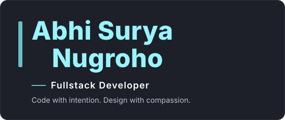

I'm a fullstack developer in Jakarta. Since September 2025 I've been at TPM Group, where I build and maintain internal web and mobile tools alongside day-to-day IT support. Before that I did a Production Engineering internship at PT Denso Indonesia and freelance work for a community organization.

For interfaces I use React, Next.js, React Native, and Flutter. Behind them sit PHP with Laravel, Express.js, and Python, with MySQL or SQL Server for data. Lately I've been exploring interactive 3D and page transitions with GSAP and Three.js. Have a project in mind? Let's talk.

[Portfolio](https://biporto.vercel.app) · [LinkedIn](https://linkedin.com/in/abhisuryanugroho) · [Email](mailto:abhisuryanu9roho@gmail.com)

## Selected work

  
  

  Left: the FixBeli ID catalog. Right: the P2HP community website.

- [FixBeli ID](https://abhisn15.github.io/katalog/), 2026. An automated content pipeline that turns a product link into a finished vertical video on its own: AI writes the script through a five-provider fallback chain, a local LLM picks matching stock footage, FFmpeg renders it, and uploads are scheduled to YouTube and Facebook, all driven from a custom Android app. The link opens its live product catalog. Built with Python, FFmpeg, Ollama, the YouTube Data API, and Android.
- [P2HP community website](https://www.p2hpkacermania.com/), 2025. Community website for Perhimpunan Pecinta Hitam Putih (P2HP) covering agenda, news, and gallery. Built with HTML, Tailwind CSS, PHP, JavaScript, and MySQL.
- P2HP mobile app, 2025. Community app with agenda, news, and gallery, built alongside the website. Shipped to Google Play; the listing is no longer active. Built with React Native, Firebase, and Node.js.
- EduSafe, 2024. Flutter app where students discuss their homework with each other, backed by Laravel and an ERD-based database design. 3rd place at LKS IT Solution, East Jakarta City level.
- [Cloubee](https://cloubee.vercel.app), 2024. Donation site that points people to verified charities. Grand finalist at the AWS Sagasitas Cloud Computing Club Competition, DKI Jakarta Province level. Built with HTML, CSS, and JavaScript.

## Experience

| Period | Role |
|---|---|
| Sep 2025 to now | IT Staff, Fullstack Developer at TPM Group, Jakarta Selatan. Joined as an intern (Sep to Dec 2025), junior IT staff since January 2026. Internal web and mobile tools alongside day-to-day IT service support. |
| May to Sep 2025 | Full Stack Developer and Digital Operations Support (freelance) at P2HP, Jakarta. Led the mobile app from UI/UX to build and deployment, and ran digital operations: product copywriting, Tokopedia and Shopee listings, live-stream setup. |
| Oct 2024 to Mar 2025 | Fullstack Developer intern, PE Dev (Digitalization), at PT Denso Indonesia, Bekasi. Web and mobile applications for logistics and digitalizing work processes, including Arduino-based barcode monitoring. |
| Jun 2024 to May 2026 | Administrative Assistant and Documentation (freelance) at Poyangbi, Bekasi. Supported Qurban, Aqiqah, and Nazar operations for Sohibul Qurban beneficiaries in Singapore, with automation and data management, and built the workflow tooling in Google Apps Script. |
| 2022 to 2025 | SMKN 40 Jakarta, Department of Information Technology, Software Engineering. |

## Stack

| Area | Tools |
|---|---|
| Full-stack | React, Next.js, React Native, Flutter, PHP, Laravel, Python, Express.js, MySQL, SQL Server, RESTful APIs, Git and GitHub |
| UI/UX and interaction | GSAP, Three.js, accessibility-first design, prototyping, micro-interactions, UI sketching |
