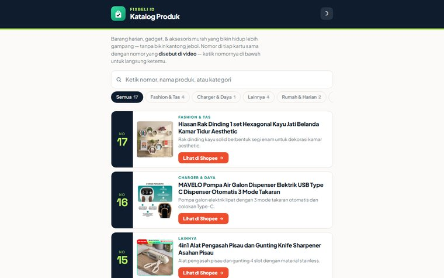
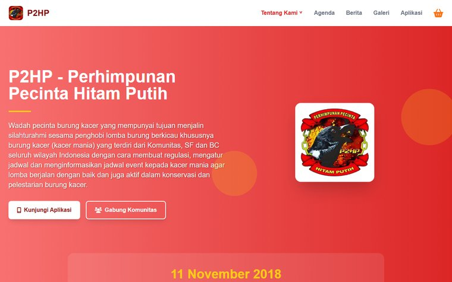

<a href="https://biporto.vercel.app">
  <picture>
    <source media="(prefers-color-scheme: dark)" srcset="assets/header-dark.svg">
    <source media="(prefers-color-scheme: light)" srcset="assets/header-light.svg">
    
  </picture>
</a>

  
  
  

### Hi, I'm Abhi 👋

Fullstack developer in Jakarta. Since September 2025 I've been at **TPM Group**, building and maintaining internal web and mobile tools alongside day-to-day IT support. Before that: a Production Engineering internship at **PT Denso Indonesia** and freelance work for a community organization.

- 🧩 **Interfaces:** React, Next.js, React Native, Flutter
- ⚙️ **Behind them:** PHP + Laravel, Express.js, Python, with MySQL or SQL Server
- 🌀 **Lately:** interactive 3D and page transitions with GSAP and Three.js

Have a project in mind? [Let's talk.](mailto:abhisuryanu9roho@gmail.com)

<picture>
  <source media="(prefers-color-scheme: dark)" srcset="assets/stack-dark.svg">
  <source media="(prefers-color-scheme: light)" srcset="assets/stack-light.svg">
  
</picture>

## ✦ Selected work

<table>
  <tr>
    <td width="50%" valign="top">
      
      <h4><a href="https://abhisn15.github.io/katalog/">FixBeli ID</a> · 2026</h4>
      An automated pipeline that turns a product link into a finished vertical video on its own: AI writes the script through a five-provider fallback chain, a local LLM picks matching stock footage, FFmpeg renders it, and uploads are scheduled to YouTube and Facebook, all driven from a custom Android app.  
      <code>Python</code> <code>FFmpeg</code> <code>Ollama</code> <code>YouTube Data API</code> <code>Android</code>
    </td>
    <td width="50%" valign="top">
      
      <h4><a href="https://www.p2hpkacermania.com/">P2HP community website</a> · 2025</h4>
      Community website for Perhimpunan Pecinta Hitam Putih (P2HP) covering agenda, news, and gallery. A companion mobile app shipped to Google Play (listing no longer active).  
      <code>HTML</code> <code>Tailwind CSS</code> <code>PHP</code> <code>MySQL</code> <code>React Native</code> <code>Firebase</code>
    </td>
  </tr>
</table>

| Project | What it is | Recognition |
|---|---|---|
| **EduSafe** · 2024 | Flutter app where students discuss homework with each other, backed by Laravel and an ERD-based database design | 🥉 3rd place, LKS IT Solution, East Jakarta City |
| [**Cloubee**](https://cloubee.vercel.app) · 2024 | Donation site that points people to verified charities (HTML, CSS, JavaScript) | 🏁 Grand finalist, AWS Sagasitas Cloud Computing Club Competition, DKI Jakarta |

## ✦ Experience

<b>IT Staff, Fullstack Developer</b> · TPM Group, Jakarta Selatan · <i>Sep 2025 – now</i>

 
Joined as an intern (Sep–Dec 2025), junior IT staff since January 2026. Internal web and mobile tools alongside day-to-day IT service support.

<b>Full Stack Developer & Digital Operations Support</b> · P2HP (freelance), Jakarta · <i>May – Sep 2025</i>

 
Led the mobile app from UI/UX to build and deployment, and ran digital operations: product copywriting, Tokopedia and Shopee listings, live-stream setup.

<b>Fullstack Developer Intern, PE Dev (Digitalization)</b> · PT Denso Indonesia, Bekasi · <i>Oct 2024 – Mar 2025</i>

 
Web and mobile applications for logistics and digitalizing work processes, including Arduino-based barcode monitoring.

<b>Administrative Assistant & Documentation</b> · Poyangbi (freelance), Bekasi · <i>Jun 2024 – May 2026</i>

 
Supported Qurban, Aqiqah, and Nazar operations for Sohibul Qurban beneficiaries in Singapore, with automation and data management, and built the workflow tooling in Google Apps Script.

<b>Software Engineering</b> · SMKN 40 Jakarta, Department of Information Technology · <i>2022 – 2025</i>

## ✦ Activity

<picture>
  <source media="(prefers-color-scheme: dark)" srcset="https://raw.githubusercontent.com/abhisn15/abhisn15/output/github-contribution-grid-snake-dark.svg">
  <source media="(prefers-color-scheme: light)" srcset="https://raw.githubusercontent.com/abhisn15/abhisn15/output/github-contribution-grid-snake.svg">
  
</picture>
